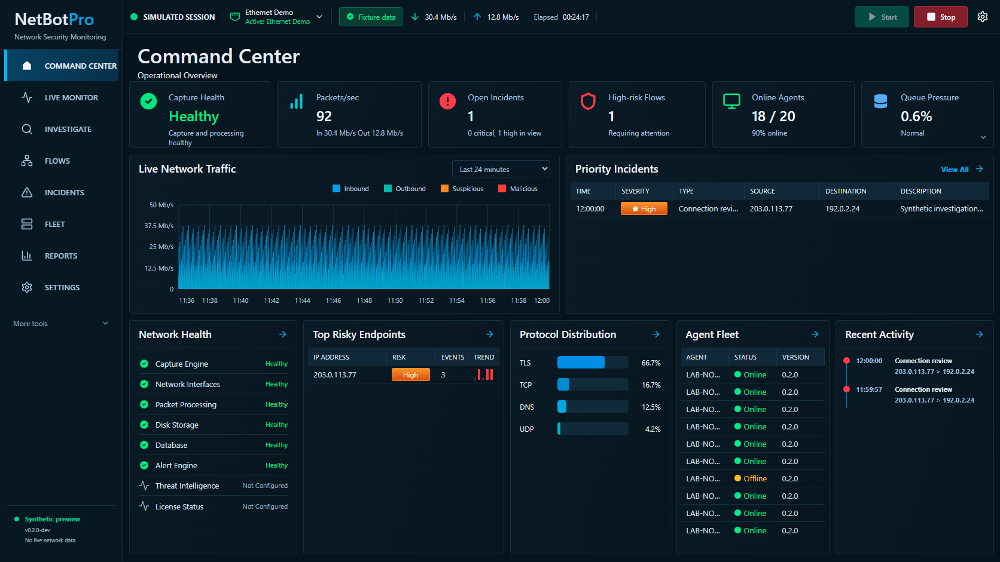
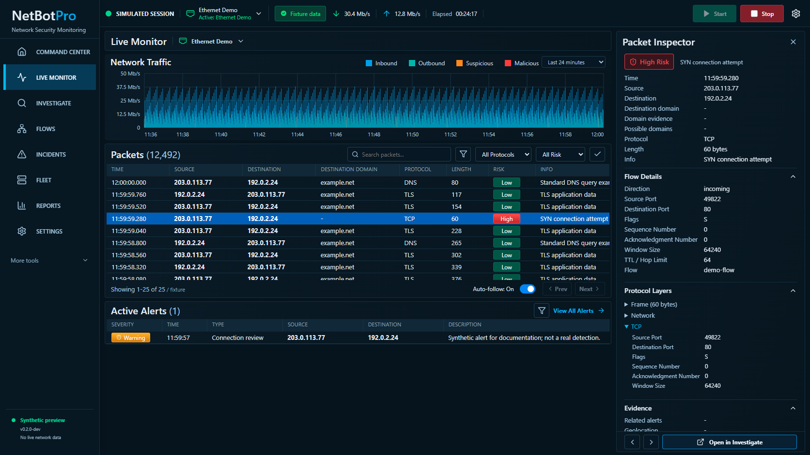
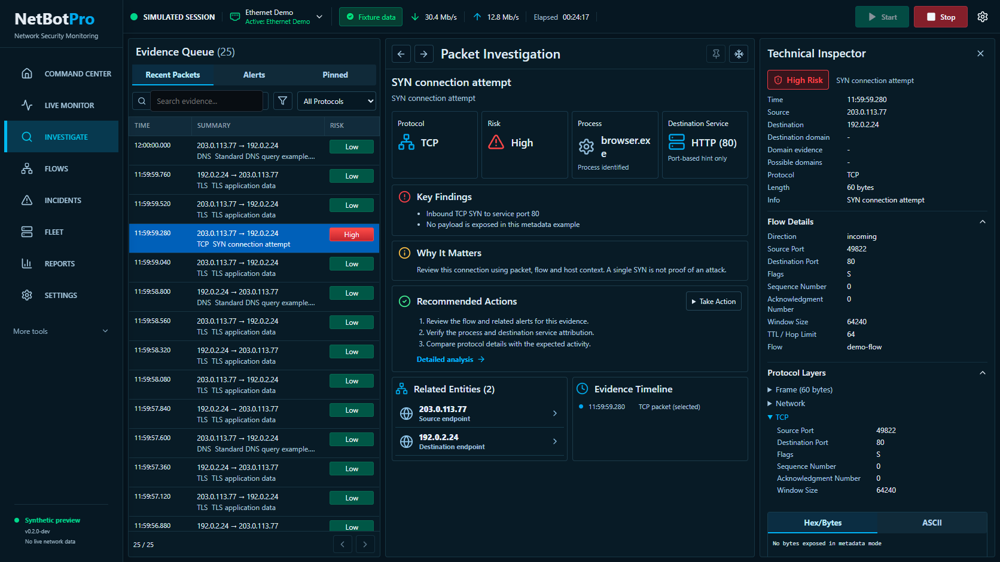
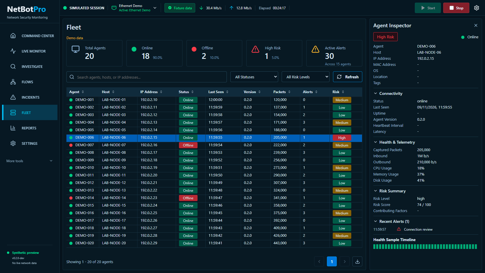
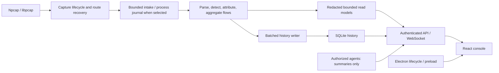

# NetBotPro

[](https://github.com/XploitGost/Netbotpro/actions/workflows/ci.yml)
[](LICENSE)

Local-first network monitoring, metadata inspection and defensive investigation.
Python/FastAPI analysis, a React console and an Electron desktop shell work with
Npcap/libpcap capture adapters. Monitor only systems you are authorized to inspect.

[فارسی](README.fa.md) | [Install](docs/INSTALL.md) | [Architecture](docs/ARCHITECTURE.md) |
[Contribute](CONTRIBUTING.md) | [Security](SECURITY.md)

## Development Status

`main` is the active **v0.2.0 development line**, not a new production release.
Historical downloads do not automatically include current source fixes. Green CI
does not establish zero packet loss, unlimited capacity or four-hour stability.

Recent work includes capture recovery, bounded pipeline stages, flow-detail
compression, domain evidence, endpoint navigation and local-sensor telemetry.
The newer desktop sources are preserved in
[`frontend/desktop-reference`](frontend/desktop-reference/README.md), but **are
not yet fully integrated into the standard frontend build**. A clean-checkout
build does not reproduce every installed experimental UI change.

## Screenshots

Actual preserved desktop components, rendered with **synthetic documentation
fixtures**, not real traffic or real security findings. The top bar marks the
simulation. These previews do not certify runtime functionality or stability.

### Command Center


### Live Monitor


### Packet Investigation


### Fleet


[Screenshot provenance and regeneration](docs/SCREENSHOTS.md).

## Capabilities And Limits

| Area | Current implementation | Limit |
| --- | --- | --- |
| Live Monitor | Packet/alert lists, filters, paging, inspector and auto-follow | The bounded live view is not complete historical capture |
| Flow Analysis | Flow Engine, conversations, risk explanations and detail compression | Active state/catalogs are not a hard global memory cap |
| Protocol Intelligence | TCP Analysis, DNS Intelligence, HTTP/TLS Metadata Intelligence and Protocol Statistics | Port-based labels are hints, not application identity proof |
| Deep Packet Inspection | Available protocol fields, safe bytes and Expert information | No TLS decryption or recovery of unavailable payload bytes |
| Investigation | Related entities, timeline, Saved Display Filters and Packet Search | One alert is not proof of compromise |
| Service Attribution / Destination Intelligence | Client-scoped DNS answers, visible SNI/Host and process context | Shared IPs, encrypted DNS and ECH can leave a domain unknown or ambiguous |
| Incident Correlation Engine | Related signals, confidence and evidence | False-positive calibration still needs validation |
| Fleet | Read-only registry, heartbeat/history and a desktop local sensor | No arbitrary host discovery or remote command execution |
| Bounded Packet Intake Queue | Queue pressure metrics and Ops Snapshot packet queue visibility | Queue capacity does not guarantee zero driver loss |
| Flow-aware Worker Pool | Ordered flow lanes, liveness and pressure counters | More threads do not guarantee Python CPU scaling |
| Live Ring Buffer | Bounded recent metadata and filtered queries | Eviction is not capture loss |
| Batch Persistence / Storage Backpressure | History batches, retries, backlog and drain checks | Crash-atomic end-to-end acknowledgement is further work |
| WebSocket Event Aggregator | Batched live updates and slow-client handling | Display delivery is not a durable packet ledger |
| Reports and offline analysis | Redacted exports and authorized PCAP analysis | Raw export is explicitly gated; review shared artifacts |
| Performance Benchmark Suite | Synthetic stages, pipeline and soak harnesses | CI smoke is not a production capacity claim |

## Architecture



Profiles/providers do not all share identical recovery or durability guarantees.
See [current architecture](docs/ARCHITECTURE.md), [ownership boundaries](docs/ARCHITECTURE_BOUNDARIES.md)
and [roadmap](docs/ROADMAP.md). Rust is a possible measured migration, **not an
implemented subsystem**.

## Run From Source

Use Python 3.13, Node.js 22.12+ and Npcap for Windows live capture.

```powershell
python -m venv .venv
.\.venv\Scripts\python.exe -m pip install -r requirements-dev.txt
npm --prefix frontend ci
npm --prefix desktop/electron ci
```

Follow [INSTALL.md](docs/INSTALL.md) and the `scripts/dev/start-local.ps1` /
`stop-local.ps1` workflow. `.env.example` describes configuration; secrets belong
in local settings, not Git. Source builds use the standard frontend, not the overlay.

## Tests And Operations

```powershell
python -m unittest discover -s tests -q
npm --prefix frontend run test:ui
npm --prefix frontend run build
node --test desktop/electron/backend-shutdown.test.cjs
python scripts/qa/repository_hygiene.py --staged
```

CI checks Python/frontend on Windows, Linux and macOS, source hygiene, dependency
advisories and Windows packaged-backend smoke. Follow the specific commit's
Actions result. [Validation rules](docs/VALIDATION.md) explain the limits.

`/api/health`, `/api/ready` and `/api/monitoring/metrics` distinguish liveness,
readiness and pressure. Capture health is not overall storage/delivery health.
Driver coverage, backlog, recent failures and display evictions are separate.

Settings include `NETBOT_PACKET_QUEUE_MAX_SIZE`, `NETBOT_PERSISTENCE_QUEUE_MAX`,
`NETBOT_FLOW_HOT_TARGET` and `NETBOT_FLOW_COLD_AFTER_SECONDS`. See the pipeline
guide before changing limits. Remote IP country does not establish which public
egress IP a policy-routing router used for a connection.

## Documentation

- [Documentation index](docs/README.md), [deployment overview](docs/DEPLOYMENT_OVERVIEW.md) and [Linux server deployment](docs/LINUX_SERVER_DEPLOYMENT.md)
- [Flow Analysis](docs/FLOW_ANALYSIS.md) and [Deep Packet Inspection](docs/DEEP_PACKET_INSPECTION.md)
- [Destination attribution](docs/SERVICE_ATTRIBUTION.md) and [incident correlation](docs/INCIDENT_CORRELATION.md)
- [Performance pipeline](docs/PERFORMANCE_PIPELINE.md), [performance validation](docs/PERFORMANCE_VALIDATION.md), [real-load testing](docs/REAL_LOAD_TESTING.md)
- [Release checklist](docs/RELEASE_CHECKLIST.md), [release QA](docs/RELEASE_QA_CHECKLIST.md), [historical v0.2.0 notes](docs/RELEASE_NOTES_v0.2.0.md)
- [Repository maintenance](docs/REPOSITORY_MAINTENANCE.md), [contributing](CONTRIBUTING.md), [security](SECURITY.md)

## Safe And Authorized Use Notice

No credential collection, browser-history scraping, TLS interception or stealth
monitoring. Agent Mode provides no remote command/control or raw payload
forwarding. Local firewall helpers and explicit response settings are separate;
review them before enabling. Metadata can still be sensitive. Prefer loopback,
least privilege, bounded retention and redacted exports. [MIT licensed](LICENSE);
the license, screenshots and test results imply no security certification.
