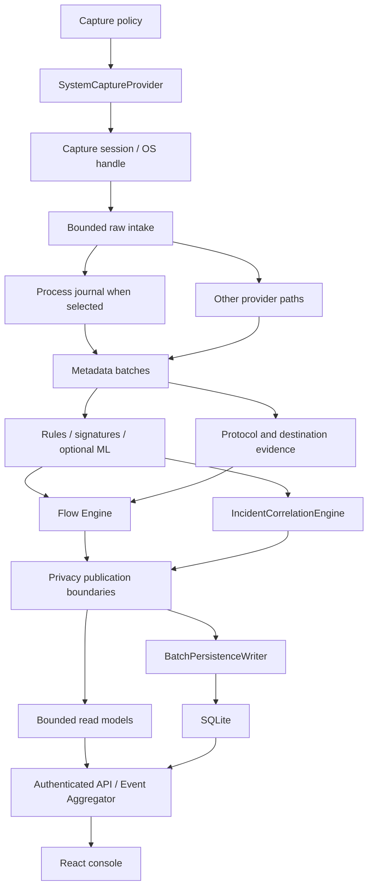

# Architecture

Source checkpoint: 2026-11-09. Implemented behavior and migration targets are
separate; this document does not claim the refactor is complete.

## Layers And Owners

| Layer | Modules | Responsibility |
| --- | --- | --- |
| Desktop | `desktop/electron/` | Backend launch/readiness, isolated preload and graceful shutdown |
| API/control | `backend/app/main.py`, security/capture policy | Authentication, lifecycle, configuration, queries and exports |
| Capture | `core/capture/`, `core/netbotpro_sniffer_core/` | Interface/route discovery, handles, intake and parsing |
| Analysis | Sniffer services, `core/flow_engine.py`, intelligence/detection | Ordered metadata, Flow Engine, Protocol Intelligence and Conversation Timeline |
| Persistence | History repository, batch writer | Redacted history, bounded batching, retries and drain |
| Read models | Ring, view batcher, event aggregator | Bounded UI/query context, separate from durable history |
| Fleet | Registry/history, `local_sensor.py`, `agent/` | Read-only summary telemetry and lifecycle |
| UI | `frontend/src/`, preserved `frontend/desktop-reference/` | Rendering, selection, navigation and filters |

## Current Logical Data Path

This is logical ownership, not identical thread/process topology on all platforms.
`SnifferService` still mixes orchestration concerns; metadata dictionaries are not
yet a fully versioned independent contract everywhere.

The first extraction now hands an `AnalyzedPacket` result from `_analyze_packet`
to `PacketDelivery` through explicit `DeliveryPorts`. Delivery owns the existing
ordered state/view/persistence/event fan-out, not capture or detector lifecycle.
Its envelope is not a sanitized or deeply immutable record, and completion is not
a durable commit acknowledgement. Legacy flow adapters may retain their existing
ingest side effects; this is not yet a pure domain-analysis implementation.
See [ADR 0001](adr/0001-packet-analysis-delivery-boundary.md) for the contract and tests.

The write-behind queue has an explicit `PersistenceFlushReceipt` contract. A
completed barrier, timeout, eviction and unavailable worker are distinct, and
newly observed failed/dropped records prevent a success result. This fixes false
success from evicted flush commands and internally handled write errors; it does
not turn the existing storage adapter into a crash-atomic commit protocol.
See [ADR 0003](adr/0003-persistence-flush-receipts.md).

## Capture, Recovery And Durability

Process capture isolates raw intake with bounded buffering, a journal and batch
delivery. Interface/route probes and typed failures support automatic recovery.
Normal desktop exit requests capture/history drain before process termination.

Driver counters, raw capacity, journal backlog, analysis failures and view evictions
are distinct. Missing driver coverage cannot prove zero wire loss. Normal drain
acknowledgement does not establish crash-atomic recovery after forced termination
or power loss. Journal reclamation and durable history still need an explicit
end-to-end acknowledgement contract.

## Performance Pipeline Foundation

`BoundedPacketQueue` and its packet queue worker support the conventional intake
path. The Flow-aware Worker Pool preserves flow ordering; additional lanes do not
guarantee parallel Python CPU throughput. Journal-based sessions have different
intake responsibilities from the conventional queue.

`FlowViewBatcher` prevents optional display flushing from synchronously blocking
the analysis owner. The Live Ring Buffer is recent context, not a complete ledger.
The WebSocket Event Aggregator batches/coalesces bounded client delivery.
`BatchPersistenceWriter` owns history batching, retry and drain. Audit logging stays outside
the asynchronous history batch queue.

## Flow State

The Flow Engine keeps headers/counters usable for filtered summaries. Idle detail
state can be losslessly compressed by `core/flow_compaction.py`. Compression runs
outside the ingest lock, with identity/version checks before commit. Traffic
re-entry restores counters/details. Read-only queries return detached views.

The current hot target is 2048 and idle threshold 120 seconds. These are not a hard
global memory cap. Active flows and ID catalogs still need archival/retention
design. Fixture retained-state savings are not whole-process RSS savings.

## Protocol, Destination And Risk

Packet Dissector output depends on captured metadata; missing fields stay unknown.
TCP hints live in `core/tcp_analysis.py`, DNS analysis in `core/dns_intelligence.py`.
HTTP/TLS metadata does not decrypt application content.

`ServiceAttributionEngine` uses scoped DNS-answer evidence, visible SNI/Host,
process context and `service_fingerprints.json`. Shared CDN IPs are not unique site
identities. TTL expiry and ambiguity are preserved. Laptop capture alone cannot
fully observe a router's downstream NAT or policy-routing egress decision.

`IncidentCorrelationEngine` groups related signals. Severity/confidence are review
aids, not autonomous verdicts. Alert calibration is separate from capture correctness.

## Privacy And Native Code

Central redaction applies at publication/persistence boundaries. Metadata remains
potentially sensitive. The optional `core/_privacy_walk.c` accelerator has Python
fallback and parity tests; generated extensions are not committed.

There is no implemented Rust subsystem. A future native core must follow measured
profiling, own a batch/state contract and pass replay parity. Crossing a language
boundary once per full Python packet dictionary is not the proposed design.

## Frontend And Desktop

The standard React source is the reproducible frontend entry point. Newer desktop
components are preserved under `frontend/desktop-reference/`, whose historical
build patches compiled baseline symbols. That compatibility path is not a complete
clean-checkout release build. Integration into explicit controller/API contracts
must precede removal of the overlay.

Electron uses context isolation, sandboxing and disabled renderer Node integration.
Preload exposes runtime configuration, not arbitrary filesystem/process access.
The exit coordinator requires authenticated backend preparation/drain before
normal termination; errors must remain visible.

## Fleet And Health

Desktop, server, sensor and agent profiles express different deployment intent.
The desktop reporter owns a reserved local identity and publishes summaries.
External agents use authenticated heartbeat/telemetry endpoints. They do not
execute commands, forward raw packets or automatically discover arbitrary hosts.

Liveness, readiness, capture, analysis, storage and delivery are independent health
dimensions. Unknown/stale measurements must not become invented healthy states.

## Migration Order

1. One authoritative source/build path; stop editing installed bundles.
2. Explicit capture batch schema, sequence, ownership and lifecycle contracts.
3. Separate analysis ownership, durable acknowledgement and optional read models.
4. Bound active/catalog state with compatible history IDs and archival.
5. Replay parity, packaged probes and uninterrupted soak qualification before release.

[Boundary plan](ARCHITECTURE_BOUNDARIES.md) | [Roadmap](ROADMAP.md) |
[Validation](VALIDATION.md) | [Repository maintenance](REPOSITORY_MAINTENANCE.md)
